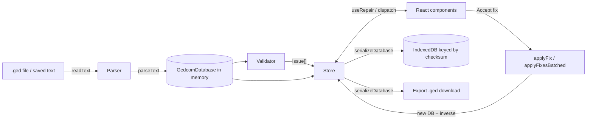

# Architecture

A reference for people and LLMs working on **gedcom-mrt**, a browser-based tool
for examining damaged GEDCOM genealogy files and repairing them with a human in
the loop. Read this before making non-trivial changes. For product framing see
[README.md](README.md).

## TL;DR

- **React + TypeScript SPA** (Vite) plus a **minimal Fastify backend**
  (`server/`). All GEDCOM processing still runs **in the browser**; the backend
  only does accounts, Stripe licensing, and zero-knowledge file storage.
- **All GEDCOM logic lives in `src/lib/` and is React-free.** The UI in
  `src/components/` is thin and reads/writes a single **Zustand** store
  (`src/state/RepairStore.tsx`).
- **The parser never throws.** Damaged input is captured as data. A parsed file
  round-trips back to text **byte-for-byte** unless a fix touched it.
- **Fixes are reviewable, applyable, and reversible.** Each produces a new
  immutable database plus its inverse (for undo).
- **Freemium:** checking a file + previewing fixes is free; **applying repairs
  and exporting require a license** ($35 one-time, 1 year). The gate is a soft
  seam in the store (`setLicenseGate` in `RepairStore.tsx`), driven by
  `state/LicenseStore.ts`.
- **Real URLs + back/forward:** `react-router-dom` with the URL mirrored to the
  store by `src/app/useUrlStoreSync.ts` (the store still drives rendering).
- Repaired sessions **autosave to IndexedDB**, keyed by a content **checksum**,
  and optionally mirror to **zero-knowledge encrypted cloud storage** (the
  browser holds the key; the server only ever stores ciphertext).
- Long lists are **virtualized**; bulk operations are **batched + chunked** so
  large files (10k+ records) stay responsive.
- **Deploy:** one container (Fastify serves the SPA + API) on **Cloud Run**, one
  GCP project per env, managed by Terraform + GitHub Actions (see `infra/`).

## Stack & commands

- React 19, TypeScript (strict), **Vite** 8 + **Vitest** (migrated off CRA).
- State: `zustand`. Routing: `react-router-dom` v7. Virtualization:
  `react-window` (v2). Tests: Vitest + React Testing Library.
- Backend (`server/`): **Fastify** 5 on Node 26, bundled with `tsup`. Firestore
  + GCS in prod; in-memory stores locally. Tested with `fastify.inject`.
- Node is provided by asdf and pinned in `.tool-versions`, so bare
  `node`/`npm`/`npx` work.

```sh
# Frontend (repo root)
npm start                 # Vite dev server at http://localhost:3000 (proxies /api)
npx vitest run            # run all frontend tests once
npm run build             # tsc typecheck + production build -> ./build

# Backend
npm --prefix server run dev     # Fastify on :8080 (in-memory store)
npm --prefix server test        # backend tests (fastify.inject)
npm --prefix server run build   # bundle -> server/dist

# One container serving both (production shape)
docker build -t gedcom-mrt .
```

The production build (`tsc`) is the type gate; there is no separate lint step.

## Data flow



Lifecycle: **load → parse → validate → review → fix → (re-validate) → export /
autosave**. After every state-changing action the store re-derives `issues`
from the current `db` via `validate()` and recomputes selection/resolved sets.

## Domain model (`src/lib/model/`)

The model is a plain object graph — no classes with behavior, no framework
types. Four layers, each in its own file.

### `Line.ts` — tokenizer

`tokenizeLine(raw, lineNumber): GedcomLine`. A GEDCOM line is
`LEVEL [@XREF@] TAG [value]`. Parsing uses an **explicit left-to-right scanner**,
not a compound regex (see _Conventions_). Key fields of `GedcomLine`:

- `level` (number, `-1` if unparseable), `tag`, `value?`
- `xref?` — the leading `@ID@` (record id), stored **without** the `@`s
- `pointer?` — set when `value` is exactly a single `@ID@` token
- `raw` — the original text, verbatim (drives faithful round-trip)
- `malformed` — true when the line didn't match the grammar (still preserved)
- `dirty?` — set by fixes on created/edited lines; tells the serializer to
  re-render this line from structured fields instead of `raw`

### `Node.ts` — record tree

`GedcomNode { line, children, parent? }`. A record is a level-0 node plus its
descendants, assembled by level number. Helpers: `getFullValue` (folds
`CONC`/`CONT` continuation children into one logical value), `walk`,
`childrenWithTag`, `createNode`.

### `Database.ts` — the parsed file

```ts
GedcomDatabase {
  records: GedcomRecord[]          // original file order (drives serialization)
  byId: Map<string, GedcomRecord>  // xref id -> record
  byType: Map<RecordType, GedcomRecord[]>
  header?, trailer?
  parseNotes: ParseNote[]          // structural problems noticed while parsing
  newline, trailingNewline, hasBom // preserved for exact round-trip
}
```

`GedcomRecord { id?, type, root }`. `RecordType` is derived from the level-0 tag
(`INDI`, `FAM`, `SOUR`, …), defaulting to `UNKNOWN`.

### `Serialize.ts` — model → text

`serializeDatabase(db)` and `serializeNode(node)`. **Fidelity rule:** a node
emits `line.raw` verbatim unless `line.dirty`, in which case it renders from
structured fields (`renderLine`). Join with `db.newline`; restore BOM/trailing
newline. Invariant: `serializeDatabase(parseText(x)) === x` for untouched input.

## Parser (`src/lib/Parser.ts`)

- `parseText(text): GedcomDatabase` — pure, synchronous, the testable core.
- `parse(file: File): Promise<GedcomDatabase>` — thin `FileReader` wrapper.

Pipeline: strip BOM → detect newline (handles `\r\n`, `\n`, lone `\r`) → tokenize
each line → build the tree with a level stack (level jumps → `BAD_LEVEL` note) →
index by id/type (duplicate ids → `DUPLICATE_XREF` note). **Never throws**;
malformed/orphan lines are attached and noted, never dropped. ~100ms for a
2.4MB / 30k-record file.

## Validation (`src/lib/Validator.ts`, `src/lib/rules/`, `model/Issue.ts`)

`validate(db, opts?): Issue[]` runs every rule and concatenates the results;
rules never mutate the db. `opts.now` (default: current time) is threaded
through so future-date checks are deterministic in tests without mocking the
clock. An `Issue` has `{ id, category, severity, message, humanMessage?,
recordIds[], lineNumbers[], suggestedFixes: SuggestedFix[], quickEdit? }`. The
`id` is **stable** (`CATEGORY:record:target`) so the UI can track an issue
across re-validation and into the resolved list.

### Severity: four tiers, by cause and certainty — not just how bad it looks

```ts
export type Severity = 'invalid' | 'error' | 'warning' | 'info';
```

| `Severity` | Label | Meaning |
|---|---|---|
| `invalid` | Invalid | **Corruption** — the file itself is damaged, not something a person typed on purpose. |
| `error` | Error | Valid GEDCOM, but **logically impossible** — cannot ever be correct. |
| `warning` | Likely error | **Possible but improbable** — plausibly real, but usually a mistake. |
| `info` | Possible issue | **Incomplete/suspect** — often legitimate, worth a look. |

`SEVERITY_LABELS: Record<Severity, string>` (in `model/Issue.ts`) supplies the
display label; the UI colors badges and issue rows by tier and sorts
worst-tier-first (`SEVERITY_ORDER` in `RepairStore.tsx`). Note `DANGLING_POINTER`
and `ASYMMETRIC_LINK` are `invalid`, not `error` — a broken/one-way pointer is a
corruption fingerprint, the same category as a malformed line, even though
fixing it is comparatively mechanical.

### Rules, by module

**`Validator.ts`** implements the two structural pointer checks directly (they
predate the `rules/` split) and composes everything else:

- `DANGLING_POINTER` — a pointer to a non-existent record. Fixes: remove the
  line, or create a stub record.
- `ASYMMETRIC_LINK` — a one-way `FAM`↔`INDI` link (e.g. `FAM` lists a `CHIL` but
  the `INDI` has no matching `FAMC`). Fix: add the reciprocal line.

**`rules/parseNotes.ts`** (tier `invalid`) — surfaces structural damage
(malformed lines, bad level nesting, duplicate xrefs, lines outside a record)
as issues, plus checks for a missing `HEAD`/`TRLR`. Flag-only. The parser
records the same findings in `db.parseNotes`, but that is a parse-time
snapshot; `structuralNotes(db)` re-derives them from the current record trees
so the issues clear when an edit repairs the damage (a parity test keeps the
two in agreement).

**`rules/dates.ts`** (tier `error`, downgraded to `warning` per-issue when a
date involved is qualified `ABT`/`EST`/`CAL` — the impossibility is then itself
uncertain) — death before birth, a future birth/death/marriage date, marriage
after death or before birth, a parent born after their child, lifespan over 123
years, burial/cremation before death, baptism/christening before birth. All
flag-only with a `quickEdit`.

**`rules/relationships.ts`** (tier `warning`) — a marriage under age 12,
overlapping ("plural") marriages with no recorded divorce or the other
spouse's death in between, an implausibly young (<13) or old (mother >60)
parent. Flag-only.

**`rules/missing.ts`** (tier `info`) — an individual with no birth or death
information, a family with no children, an individual with no `SOUR`
citations. Flag-only, no `quickEdit` (there's no existing value to correct).

**`rules/structural.ts`** — self-referential relationships and circular
ancestry (tier `error`: a standard DFS cycle-detection pass over the
`FAMC`→family's `HUSB`/`WIFE` graph, `O(V+E)`), plus likely-duplicate
individuals and orphan/unlinked individuals (tier `info`). An individual
referenced by a `FAM`'s `HUSB`/`WIFE`/`CHIL` but missing their own back-pointer
is **not** counted as an orphan — that's `ASYMMETRIC_LINK`'s job; orphan
detection checks both directions.

**`rules/accessors.ts`** — shared field accessors used by the above:
`birthEvent`/`deathEvent`/`marriageEvent` (read a `BIRT`/`DEAT`/`MARR` node
plus its parsed `DATE` child and the child's node path), `famMembers`,
`parentFamIds`/`spouseFamIds`, `getSex`, `RuleOpts`/`todayParts`.

### Dates (`src/lib/model/GedcomDate.ts`)

No date parser existed before this; GEDCOM dates are free-form tokens, not a
strict grammar, so `parseGedcomDate` scans token-by-token (hand-written, no
compound regex) rather than reusing `Line.ts`'s scanner shape. Handles `DD MMM
YYYY`/`MMM YYYY`/`YYYY`, the `ABT`/`EST`/`CAL`/`CALC`/`INT` approximation
qualifiers, `BEF`/`AFT`, and `BET x AND y`/`FROM x TO y` ranges.

Comparisons (`isDefinitelyBefore`/`isDefinitelyAfter`/`isDefinitelyAfterToday`)
are **conservative**: a partial date (year only, or year+month) is treated as
the full range of days it could mean, and two dates are only "definitely"
ordered when their ranges can't overlap — e.g. a birth recorded only as "1950"
is never flagged against a death in "MAR 1950", since the birth could plausibly
have happened in Jan/Feb. This is what keeps the `error` tier's impossible-date
rules from false-positiving on imprecise (but real) genealogical data.
`approxYearsBetween` is the looser, best-guess counterpart used by the
`warning`-tier age heuristics in `rules/relationships.ts`, where an estimate is
the point.

`message` is technical (uses `@xref@`); `humanMessage` is plain-language using
names, built via `src/lib/Describe.ts` (`nameOf`, `describeFamily`, …).

### Quick edit (`Issue.quickEdit`, `src/components/QuickEdit.tsx`)

Most semantic rules are flag-only (`suggestedFixes: []` — the tool never
deletes a genealogical date on the user's behalf). Rather than sending every
one of those to the raw per-line record editor, an issue can carry
`quickEdit?: QuickEditField[]`, each `{ recordId, path, label, value,
allowClear? }` pointing at the exact `DATE` (or similar) line. `IssueDetail`
renders `<QuickEdit>` when present: a plain-labeled text input per field,
pre-filled with the current value. Saving diffs each field against its
original value and applies **`EditLine`** (changed) or **`RemoveNode`**
(cleared, if `allowClear`) — one `APPLY_FIX` dispatch per changed field,
through the same reversible Fix engine as everything else. No new `Fix` kind
was needed.

## Fix engine (`src/lib/model/Fix.ts`)

A `Fix` is a discriminated union addressed by **node path** (`{recordId,
path: number[]}`), not object identity, so it survives re-parsing:

`AddNode | RemoveNode | EditLine | AddRecord | RemoveRecord | ReplaceRecord`.

- **`applyFix(db, fix): {db, inverse}`** — returns a NEW db (immutable, clones
  the touched record and rebuilds indexes) plus the inverse fix for undo. Used
  for single accepts and manual edits.
- **`applyFixesBatched(base, fixes): {db, applied[]}`** — the fast path for bulk:
  clones each touched record once, maintains indexes **incrementally** (no
  per-fix rebuild), does **not** re-validate between fixes. Only handles
  `AddNode`/`RemoveNode` (what bulk produces). Callers must pre-order with
  **`orderBulkFixes`** (removes descending-per-record, then appends) so a single
  pass is correct without re-validation.
- **`previewFix(db, fix)`** — before/after text of the affected record, for the
  review diff.

Construction helpers: `makeLine`, `makeNode`, `makeStubRecord`. Manual edits and
accepted suggestions both flow through the same apply functions.

## State (`src/state/RepairStore.tsx`)

A single **Zustand** store holds the whole session. Shape (`RepairState`):

```
db?, fileName?, fileId? (checksum), restored,
issues[], resolved[], applied[] (undo), undone[] (redo),
filter (category), severityFilter (tier), selectedIssueId?, selectedIssueIds[] (bulk checkboxes),
editingRecordId?, editorDirty,
bulkInProgress, bulkDone, bulkTotal
```

`filter` and `severityFilter` are independent, ANDed dimensions —
`visibleIssues(issues, filter, severityFilter)` applies both. `sortIssues`
orders worst-tier-first (`SEVERITY_ORDER`, matching the four `Severity` values).

Actions are store methods: `load`, `applyFixAction`, `bulkAccept` (async,
chunked), `undo`, `redo`, `setFilter`, `setSeverityFilter`, `selectIssue`, `toggleIssueSelected`,
`setIssueSelection`, `editRecord`, `closeEditor`, `setEditorDirty`, `reset`.

**Compatibility layer:** components use `const { state, dispatch } = useRepair()`
and dispatch action *objects* (`dispatch({type:'APPLY_FIX', fix})`); `dispatch`
routes to the matching store method. This kept the migration from the old
reducer cheap. Pure selectors `visibleIssues`/`sortIssues` are exported for
components and the store to share ordering.

Other exports:

- `useLeaveGuard()` → `canLeave()`, which returns `true` unless the editor is
  dirty, in which case it confirms discarding. **Every navigation-away action**
  (record pager, cancel, list clicks, filter change, undo/redo) is gated by it.
- `RepairProvider` — mounts once; subscribes to `db` changes and **autosaves**
  (debounced 600ms) the serialized text to IndexedDB keyed by `fileId`. There is
  **no silent restore** — the start screen lists saved files instead.

Derived-set discipline: after any action that changes `issues`, the store
recomputes `resolved` (via `updateResolved`), prunes `selectedIssueIds`, and
advances `selectedIssueId`. Keep this consistent when adding actions.

## Persistence (`src/lib/idb.ts`)

IndexedDB, store `files` (schema `VERSION = 3`), **keyed by a content
checksum**, not filename. `SavedFile { id (=checksum), checksum, name, text,
savedAt, size }`. We store **serialized text**, not the node tree (which has
`parent` cycles that structured-clone can't handle); re-parsing on open is
cheap.

Consequences of checksum-keying: two different files with the same name are kept
separately (no accidental overwrite); re-uploading identical content is detected
as a duplicate. `checksum(text)` uses SHA-256 (Web Crypto) with a cheap-hash
fallback. API: `saveSession(id, name, text)`, `listSessions()` (metadata,
newest first), `loadSessionById(id)`, `deleteSession(id)`. All degrade to
no-ops when `indexedDB` is absent (e.g. jsdom tests).

## UI (`src/components/`, `App.tsx`)

`App.tsx` shows `FileLoader` when there's no `db`, otherwise the shell:
header (`ExportBar`, New file) + `Sidebar` (left) + content pane (right).

| Component | Role |
|---|---|
| `FileLoader` | Upload a file (checksum → dedupe) or open/delete a saved one. |
| `Sidebar` | Tabs: Issues / Resolved / Records. Header fixed; body scrolls. |
| `IssueList` | Tier + type filters, checkboxes + select-all, Bulk Actions, virtualized rows tinted/badged by severity tier. |
| `IssueDetail` | Prev/next `Pager`, human+technical message, tier badge, suggested fixes (`FixDiff` + green Accept) or `QuickEdit`, Edit Manually. |
| `QuickEdit` | Plain-labeled input per `issue.quickEdit` field, pre-filled; Save applies `EditLine`/`RemoveNode` fixes. |
| `ResolvedList` | Read-only virtualized list of cleared issues. |
| `RecordList` | Virtualized, filterable browser of records with ids. |
| `RecordEditor` | Structured per-line editor; validates on Save; `Pager` across records; unsaved-changes guard. |
| `FixDiff` | Line-level before/after via `previewFix`. |
| `Pager` | Shared grouped prev/next (hidden at the ends). |
| `VirtualList` | Wraps `react-window`; renders plainly under `VIRTUALIZE_OVER` (100) items, virtualizes above. |
| `BulkProgress` (in `App.tsx`) | Modal overlay driven by `bulkInProgress`/`bulkDone`/`bulkTotal`. |

## Performance notes

- **Virtualization** is the main render win: lists over 100 items render only
  on-screen rows. A 4,398-issue / 12k-record file keeps ~15 rows in the DOM.
- **Bulk accept** was O(N×records) (validate+rebuild per fix, minutes). Now:
  `orderBulkFixes` → `applyFixesBatched` in chunks of 400 with `await` yields
  (progress overlay) → **one** final `validate`. ~200ms for 4,398 fixes.
- Parse/validate are fast (~100ms each at 30k records) and run on the main
  thread; a Web Worker is a future option if files get much larger.

## Testing

- Domain logic under `src/lib/**` has fast unit tests (tokenizer table, parser
  **round-trip**, each validator rule, fix apply/invert, batched apply).
- `src/App.test.tsx` drives full flows with RTL (load → detect → accept → clear,
  manual edit + validation, bulk actions, unsaved-changes guard).
- `src/setupTests.ts` mocks `ResizeObserver` (for react-window) and **resets the
  Zustand singleton between tests** (`cleanup()` then `setState(getInitialState,
  true)`) — essential because the store is module-level state.
- jsdom has no IndexedDB, so persistence/dedupe paths no-op in tests and are
  verified in a real browser instead.

## Product surface: routing, licensing, cloud, backend

New code lives under `src/app/` (React/routing/product) and `server/` (backend);
the domain core in `src/lib/` stays framework-free.

- **Routing (`src/app/`).** `AppRoutes.tsx` maps URLs to screens; `AppShell.tsx`
  is the store-driven workspace. `useUrlStoreSync.ts` mirrors the store to the
  URL and applies back/forward — **the store still decides what renders**; the
  URL is a mirror, and the two effects short-circuit on equality so they can't
  loop. The sidebar tab lives in the store (`sidebarTab`) so it's part of that
  single synced source; `filter` and `severityFilter` mirror the same way
  (`?filter=`/`?severity=` query params).
- **Licensing (`src/state/LicenseStore.ts`).** Holds auth + license state and
  wires the store's gate seam. The gate is **soft**: applying/exporting is
  blocked only when we *know* the user is unlicensed (signed out, or no active
  license); while unknown/offline it allows. `LockBadge` + `UpsellModal` are the
  UI; `ExportBar` gates export directly (it isn't a store action).
- **Cloud (`src/lib/crypto/keys.ts`, `src/lib/cloud.ts`,
  `src/state/CloudKeyStore.ts`).** Envelope encryption: a random DEK encrypts
  files (AES-GCM) and is wrapped by a passphrase-derived KEK and a recovery key.
  The DEK lives in memory only (never persisted). `cloud.ts` mirrors `idb.ts` but
  encrypts before upload; `CloudSync.tsx` tees the autosave to the cloud.
- **Backend (`server/`).** Fastify. `store/` is a `DataStore` interface with
  memory + Firestore impls; `blobs.ts` is memory + GCS. Routes: `auth` (email
  +password, `bcryptjs`, JWT session cookie), `oauth` (Google), `license`,
  `billing` (Stripe Checkout + signature-verified webhook — the webhook is the
  source of truth for granting a license), `keybag`/`files` (license-gated,
  ciphertext only). `app.ts` also serves the SPA with an index.html fallback.

## Conventions & invariants (preserve these)

1. **Keep React out of `src/lib/`.** Domain code is framework-free and unit-
   testable. UI holds no GEDCOM logic.
2. **Prefer hand-written parsing over regex.** Where regex is unavoidable, keep
   it trivial (a digit check), never a compound catch-all.
3. **Never throw on bad GEDCOM.** Capture problems as `parseNotes`/`Issue`s /
   `malformed` lines. Every source line must remain representable.
4. **Preserve round-trip fidelity.** Only fix-touched lines set `dirty`;
   everything else re-emits `raw`. Don't mutate `raw`.
5. **Fixes are immutable + reversible.** `applyFix` returns a new db and an
   inverse; never mutate the input db. Route manual and suggested edits through
   the same apply functions.
6. **Stable issue ids.** Derive from semantic identity so tracking across
   re-validation and undo works.
7. **Gate navigation with `useLeaveGuard`** whenever an action would leave a
   dirty editor.
8. **Large-list rendering goes through `VirtualList`**; keep rows fixed-height.

## How to extend

- **Add a validation rule:** write a `(db, opts?) => Issue[]` function — in one
  of the `src/lib/rules/*.ts` modules if it's semantic ("valid GEDCOM, but the
  data is wrong"), or in `Validator.ts` if it's structural. Give issues a
  stable id, pick the right `severity` tier (see the table above — tier
  reflects *why* something is wrong, not just how bad it looks), a
  `humanMessage` via `Describe.ts`, and either one or more `suggestedFixes` or
  (if there's no safe auto-fix) a `quickEdit` pointing at the offending
  field(s). Add the call to `validate()` in `Validator.ts`. If it should
  participate in bulk accept, make its primary fix an `AddNode`/`RemoveNode`.
- **Add a fix kind:** extend the `Fix` union in `Fix.ts`, implement it in
  `applyFix` (with a correct inverse), and handle it in `affectedRecordId`. If
  bulk should use it, extend `applyFixesBatched`/`orderBulkFixes` too. (Quick
  edit didn't need this — it composes `EditLine`/`RemoveNode`, which already
  existed.)
- **Add UI:** put a new component in `src/components/`, read via `useRepair()`,
  dispatch action objects, and add store actions if new state is needed
  (remember the derived-set discipline and leave guard).

## Known limitations

- Missing required subrecords (e.g. a name) and unknown-tag detection are not
  yet implemented (see the `IssueCategory` roadmap in `model/Issue.ts`).
- Date comparisons are conservative by design (see `GedcomDate.ts`) — they
  favor missing a genuinely-impossible date over flagging an imprecise-but-real
  one, so some real errors with only partial dates won't be caught.
- Autosave persists repaired **text**, so **undo history does not survive a
  reload**.
- Bulk accept and quick edit (when it touches more than one record) each record
  one undo step per fix, not one atomic step for the whole action.
- Whole file is held in memory as a node tree; parse/validate are main-thread.
- GEDCOM 7.0 is out of scope; the tag dictionary is 5.5.1-based with broad
  real-world tolerance.
